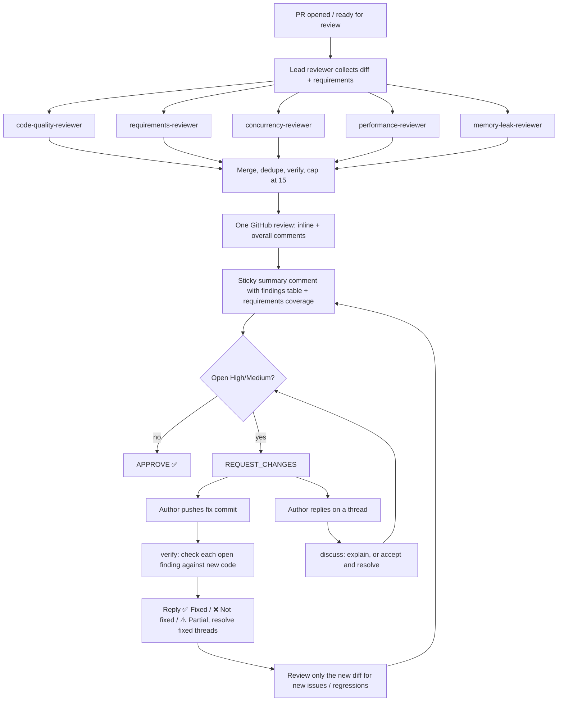

# Claude PR review workflow

Automated review of every pull request across five aspects: **Code Quality**, **Requirements**,
**Concurrency**, **Performance** and **Memory Leak**. Claude posts short, severity-tagged comments
(inline or overall), waits for the author's fix commits, checks each fix, and then approves or
requests changes again.

## Flow



| Event | Job / mode | What happens |
|---|---|---|
| PR `opened`, `reopened`, `ready_for_review` | `review` / review | Full review of the whole PR diff |
| New commits (`synchronize`) after a review | `review` / verify | Checks fixes, reviews only `last-reviewed..HEAD` |
| New commits with no previous review | `review` / review | Full review |
| Force-push / rebase | `review` / verify | Checks fixes against the whole PR diff |
| Reply on a Claude finding thread | `discuss` | Answers once: accepts and resolves, or explains |
| Comment `/claude-review` (maintainers) | `review` / review | Fresh full review |
| Draft PRs, bot PRs | (skipped) | Nothing |

## Comment format

```
🔴 High · Concurrency · Check-then-act race on `versionCache`

Concern: Two requests can both miss the cache and publish different versions.
Violates: Atomicity of compound actions (check-then-act)

Fix: Make the lookup and insert one atomic step.
  [suggestion block]
CR-3 · claude-review
```

Severity: 🔴 High and 🟠 Medium block approval; 🟡 Low never blocks.
Full spec: [`.github/claude-review/comment-format.md`](../.github/claude-review/comment-format.md).

## Files

| Path | Purpose |
|---|---|
| `.github/workflows/claude-pr-review.yml` | Triggers, mode detection, runs Claude |
| `.github/claude-review/review.md` | Instructions for the first full review |
| `.github/claude-review/verify.md` | Instructions for re-reviewing after fix commits |
| `.github/claude-review/discuss.md` | Instructions for replies on finding threads |
| `.github/claude-review/policy.md` | Severity, confidence bar, approval rules, requirement sources |
| `.github/claude-review/comment-format.md` | Exact comment/summary formats and hidden markers |
| `.claude/agents/*-reviewer.md` | The five specialist subagents (Java/Spring/JPA/Kafka checklists) |
| `.claude/commands/review-pr.md` | `/review-pr <n>` to run the same review locally (dry run by default) |

State is kept **in the PR itself** through hidden HTML markers, with no database:
`claude-review:finding` (each finding), `claude-review:verdict` (each fix check) and
`claude-review:summary sha=…` (last reviewed commit).

## One-time setup

1. **Install the Claude GitHub App** on the repo: <https://github.com/apps/claude>
   (or run `/install-github-app` in Claude Code locally, which does steps 1–2 for you).
2. **Add a secret** under Settings → Secrets and variables → Actions:
   - `ANTHROPIC_API_KEY` (API key from console.anthropic.com), **or**
   - `CLAUDE_CODE_OAUTH_TOKEN` (from `claude setup-token`, for Pro/Max plans). Then switch the
     commented line in the workflow.
3. **Allow Actions to approve PRs:** Settings → Actions → General → Workflow permissions →
   tick **"Allow GitHub Actions to create and approve pull requests"**. Without it Claude can still
   comment and request changes, but its approval is posted as a plain comment.
4. Optional, for branch protection: require 1 approving review. Claude's approval comes from
   `github-actions[bot]`. Add human reviewers too if you want a person to sign off.

## Writing PRs that get good requirement checks

Link the issue (`Closes #12`) or add a checklist to the PR description:

```markdown
## Acceptance criteria
- [ ] Publishing a product set creates a new immutable version
- [ ] Previous versions remain readable by version number
- [ ] Publishing the same set twice concurrently yields two distinct versions
```

## Tuning

- **Noise:** raise or lower the confidence bar and the 15-finding cap in `policy.md`.
- **Stack-specific rules:** edit the checklists in `.claude/agents/*.md`.
- **Cost:** `--max-turns` in the workflow; verify runs are cheaper because they only look at the new diff.
- **Try locally first:** `claude` → `/review-pr 12` (dry run) → `/review-pr 12 --post`.
